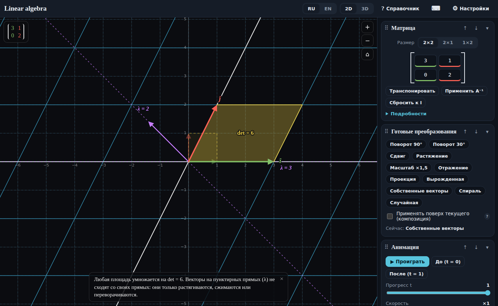
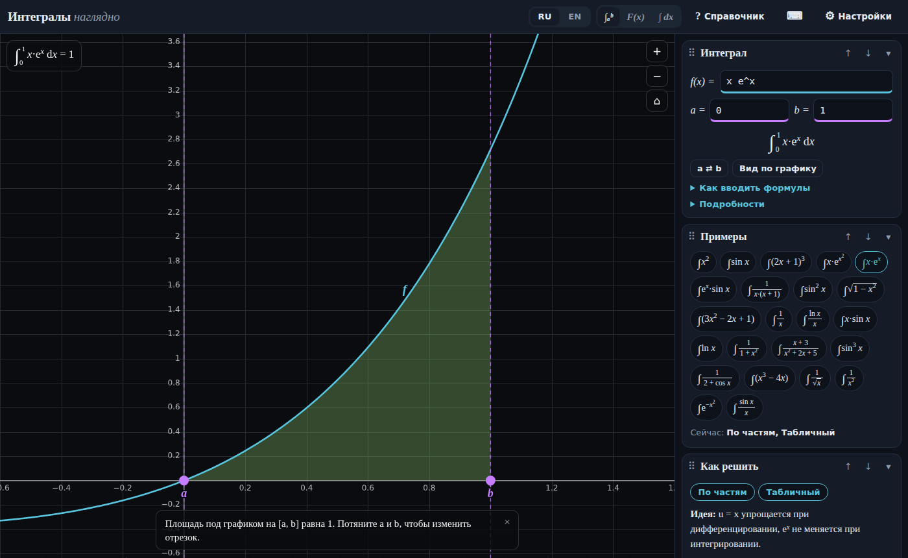
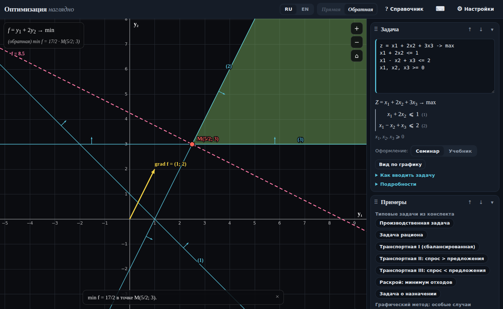
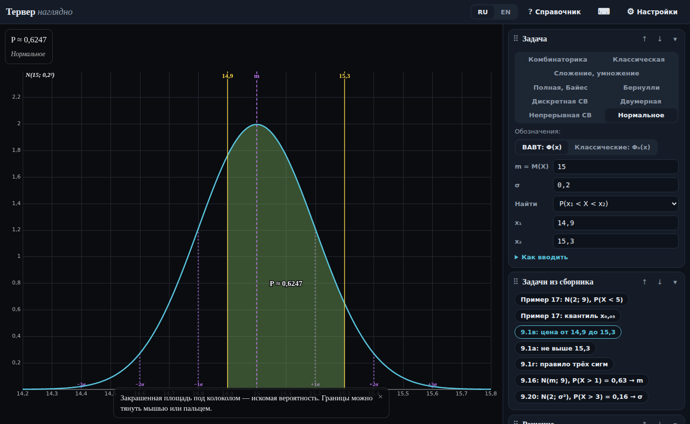
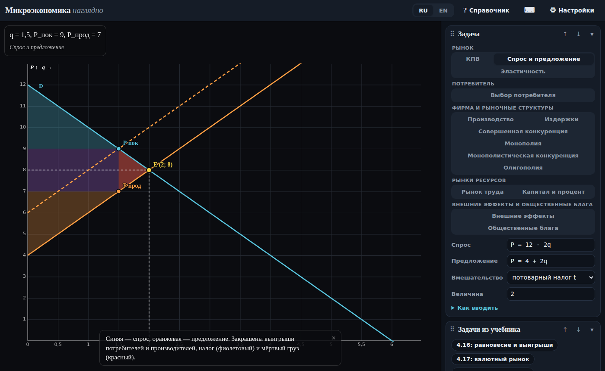
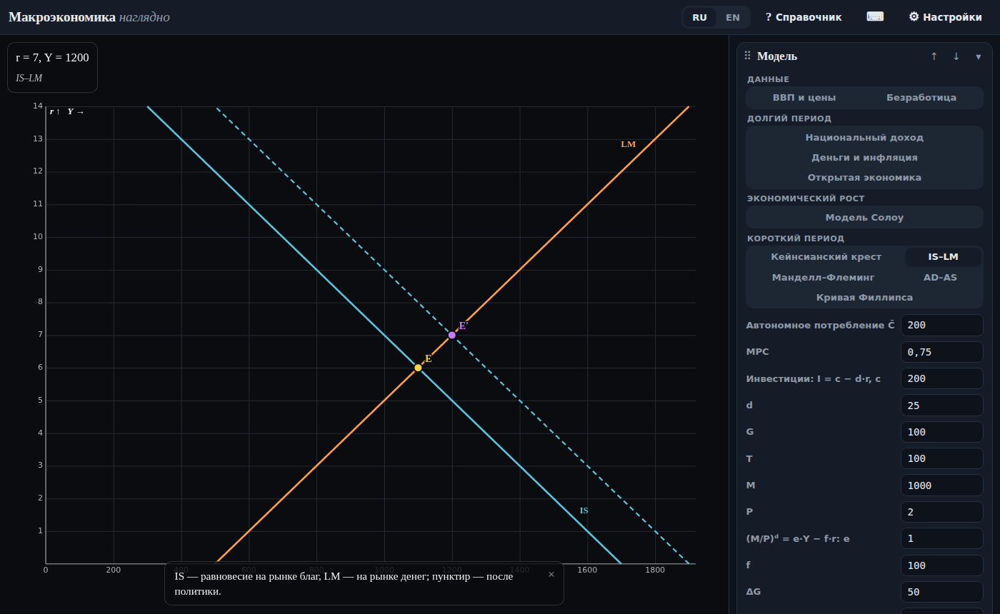
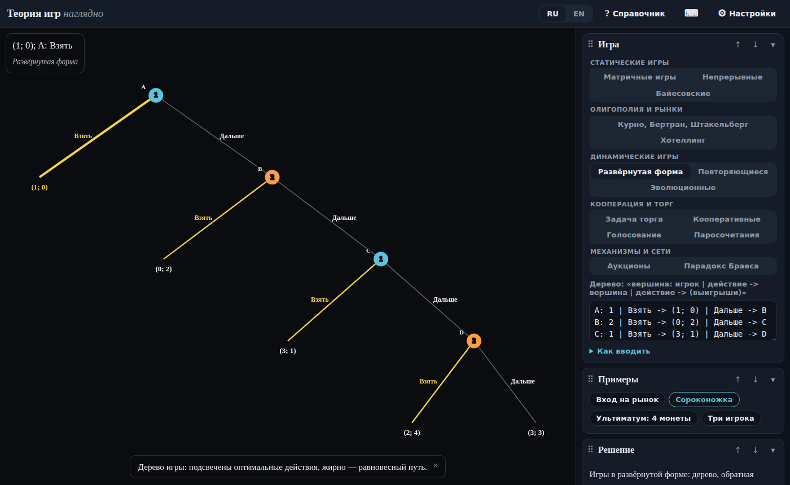

# Математика наглядно

Интерактивные тренажёры по математическим курсам для студентов ВАВТ: графики можно тянуть руками, задачи решаются по шагам, а встроенный справочник объясняет понятия интуитивно и строго.

**Открыть онлайн:** [Математика наглядно — тренажёры для студентов ВАВТ](https://musalimov.github.io/VAVT-Math/)

| | Приложение | Что внутри |
|---|---|---|
|  | [**Линейная алгебра**](https://musalimov.github.io/VAVT-Math/linear-algebra.html) | Матрицы как преобразования плоскости и пространства, определитель, собственные векторы, ранг, 2D и 3D |
|  | [**Интегралы**](https://musalimov.github.io/VAVT-Math/integrals.html) | Решение любого интеграла по шагам (замена, по частям, простейшие дроби, тригонометрия), определённый, неопределённый и несобственный интеграл, суммы Римана |
|  | [**Методы оптимальных решений**](https://musalimov.github.io/VAVT-Math/optimization.html) | Графический метод, двойственная (обратная) задача, дополняющая нежёсткость, симплекс-таблицы, все решения, теневые цены и устойчивость; режим «как на семинаре» |
|  | [**Теория вероятностей**](https://musalimov.github.io/VAVT-Math/probability.html) | Все 9 разделов задачника ВАВТ: комбинаторика, классическая вероятность, сложение и умножение, Байес, Бернулли и Муавр–Лаплас, дискретные, двумерные и непрерывные величины, нормальное распределение |
|  | [**Микроэкономика**](https://musalimov.github.io/VAVT-Math/microeconomics.html) | По учебнику Серякова (ВАВТ), с опорой на Мэнкью и Пиндайка–Рубинфельда: КПВ, спрос и предложение (налог, субсидия, потолок и пол цены, квота), эластичность, выбор потребителя (эффекты Хикса и Слуцкого), производство и изокванты, издержки, совершенная конкуренция, монополия и дискриминация, монополистическая конкуренция, олигополия и HHI, рынок труда и монопсония, капитал и дисконтирование, внешние эффекты и общественные блага |
|  | [**Макроэкономика**](https://musalimov.github.io/VAVT-Math/macroeconomics.html) | По учебнику Мэнкью «Macroeconomics»: ВВП, дефлятор и ИПЦ, естественная безработица и закон Оукена, рынок заёмных средств, количественная теория и денежный мультипликатор, малая открытая экономика, модель Солоу и золотое правило, кейнсианский крест, IS–LM, Манделл–Флеминг, AD–AS, кривая Филлипса |
|  | [**Теория игр**](https://musalimov.github.io/VAVT-Math/game-theory.html) | 14 типов игр в пяти разделах: матричные, непрерывные и байесовские игры, Курно, Штакельберг, Бертран, Хотеллинг, деревья и обратная индукция, повторяющиеся и эволюционные игры, задача торга, ядро, вектор Шепли и преднуклеолус, индексы силы, Гейл–Шепли, аукционы, парадокс Браеса |

## Как пользоваться

- **Онлайн** — по ссылке выше, ничего устанавливать не нужно; работает и на телефоне.
- **Офлайн** — откройте нужный тренажёр по ссылке, сохраните страницу (`Ctrl+S` / «Сохранить как») и открывайте файл его двойным щелчком в любом браузере. Без интернета вместо фирменных шрифтов подставятся системные, всё остальное работает.

Настройки, порядок блоков и отметки «прочитано» в справочнике хранятся только в вашем браузере. Никаких аккаунтов и аналитики.

## На чём основано

- «Методы оптимальных решений» — по учебнику *«Избранные лекции по методам оптимизации»* и материалам семинаров (двойственная задача через транспонирование таблицы, балансовые переменные).
- «Теория игр» — по главам 6–9 того же учебника по методам оптимизации (равновесие Нэша, задача торга, кооперативные игры, аукционы), дополнено стандартными темами курса.
- «Теория вероятностей» — по задачнику ВАВТ; обозначения как в нём (Φ(x) — функция распределения N(0; 1) от −∞), есть переключатель на классическую Φ₀(x). Ответы приложения сверены с ответами задачника.
- Номера задач и их краткие условия приведены для удобства подготовки; полные условия — в исходных пособиях.

## Как устроено

Каждое приложение для студента — один самодостаточный HTML-файл: разметка, стили и JavaScript без фреймворков. Внешняя зависимость одна — шрифты Google Fonts.

Файлы для студентов собираются из `src/` командой `npm run build` в папку `dist/`; GitHub Actions публикует её на Pages под прежними адресами.

Состояние интерфейса публикуется в атрибутах `<body>`: во всех тренажёрах — `data-drawer` (`none` · `gloss` · `keys` · `settings`) и `data-rec` (`idle` · `recording`); в «Линейной алгебре» ещё `data-anim` (`idle` · `playing` · `queued` · `scrub`), `data-gesture`, `data-mode`, `data-shape`. Переключатели отдают состояние через `aria-pressed`. По этим атрибутам удобно писать стили и автотесты.

## Разработка

Нужен Node ≥ 20. Для сборки и тестов зависимости не нужны; Playwright — только для сверки внешнего вида (`npm run e2e`).

```
npm run build        # dist/ — по одному самодостаточному HTML на тренажёр
npm run watch        # пересборка при каждом изменении src/
npm test             # node --test: математика, решатели, настройки, сборщик
npm ci && npx playwright install chromium
npm run e2e          # сверка dist/ с эталоном: тексты всех примеров и снимки экрана
npm run e2e -- integrals   # только указанные тренажёры
```

### Структура

```
src/
  shared/            общее для всех тренажёров (без фреймворков)
    i18n.js          текущий язык: langFrom(() => P.lang), lang()
    format.js        числа: fmt, fN, fNsci (m·10ᵏ), запятая в русском
    prefs.js         настройки: схема 2, миграция со схемы 1, копия в -bak
    state.js         pub(): состояние интерфейса в <body data-*>
    dom.js           $, clone, setOn (класс .on + aria-pressed)
    toast.js  drawers.js  panels.js  glossary.js  keys.js  settings.js
    export.js        PNG, копирование, видео (по желанию тренажёра)
    esc.js           экранирование текста пользователя для HTML
    econ/            общее для макро, микро, игр и ТВ
      app.js         каркас createEconApp(…): раздел, ввод, пересчёт, холст, запуск
      curves.js      кривые макро и микро: перетаскивание, шоки, «факторы и сдвиги»
      expr-xy.js     разбор выражений от x, y;  txb.js — общие тексты
  math/              чистая математика, без DOM — проверяется в Node
    fractions.js     точные дроби на BigInt;  simplex.js — симплекс-метод
    linalg.js        матрицы 2×2 и 3×3: det, inv, ядро, собственные значения
    expr/            выражения от x: разбор, упрощение, печать, производная,
                     численное и символьное интегрирование, пределы
  apps/<тренажёр>/
    index.html       каркас страницы (подключает ./app.css и ./app.js)
    app.js           интерфейс: сцена, рисование, свои обработчики
    app.css
    solvers/         решатели: вход → результат + шаги, без DOM
    content/         тексты (tx.js), справочник (glossary.js), примеры, клавиши
tests/
  *.test.mjs         node --test
  golden/*.json      ответы эталона для решателей (снимаются capture.mjs)
  e2e/compare.mjs    сверка сборки с эталоном; эталоны — tests/e2e/refs.json
build.mjs            сборка: ES-модули → один <script>, CSS → <style>
```

Исходники — обычные ES-модули (`import` / `export`). С `file://` браузер их не загружает, поэтому студенту выдаётся собранный файл: каждый модуль в нём живёт в своей области видимости. Поддерживаемый синтаксис описан в начале `build.mjs` (одно объявление на `export const`, без `export let` и `export default`).

### Как добавить…

**Задачу (пример) в раздел.** Добавьте строку в `PRE` нужного раздела (`src/apps/<тренажёр>/content/topics.js` или `examples.js`): идентификатор, ввод, подписи на двух языках. Затем снимите эталон: `node tests/golden/capture.mjs <тренажёр>` — и убедитесь, что `npm test` проходит.

**Раздел в экономический тренажёр.** В `content/topics.js` — раздел в `TOPICS` и форма ввода в `FORMS`; в `solvers/compute.js` — `COMP[раздел](ввод) → результат` (ошибки ввода — `throw { msg }` с текстом в `content/tx.js`); в `solvers/steps.js` — `SOLVE[раздел](результат, ввод) → { ans, st }`; рисование — в `app.js`. Каркас (`createEconApp`) подхватит раздел сам.

**Термин в справочник.** `content/glossary.js`: запись в `TERMS` (ru, en), по желанию — формальная вкладка в `FORMAL`, «см. также» в `REL`, демо в `DEMOS`.

**Новый тренажёр.** Папка `src/apps/<имя>/` с `index.html`, `app.css`, `app.js`; оболочку берите из `src/shared` (по образцу любого тренажёра), экономический — через `createEconApp`. Сборка найдёт папку сама; ссылку добавьте на лендинг (`src/apps/index`) и в таблицу выше.

Подробнее о правилах — в [CONTRIBUTING.md](CONTRIBUTING.md).

## Ошибки и идеи

Если нашли неверный ответ или опечатку, откройте [Issue](https://github.com/Musalimov/VAVT-Math/issues): укажите приложение, раздел и входные данные (удобнее всего — скриншот).

## Лицензия

[MIT](LICENSE) — можно свободно пользоваться и дорабатывать с сохранением указания авторства.
