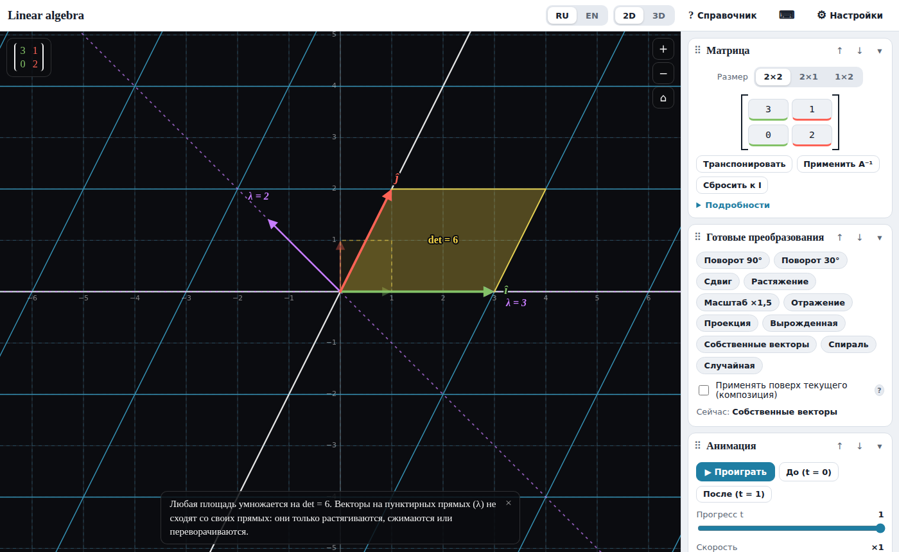
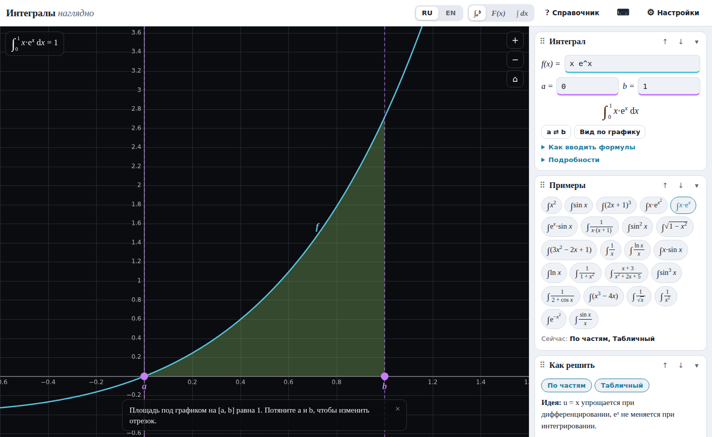
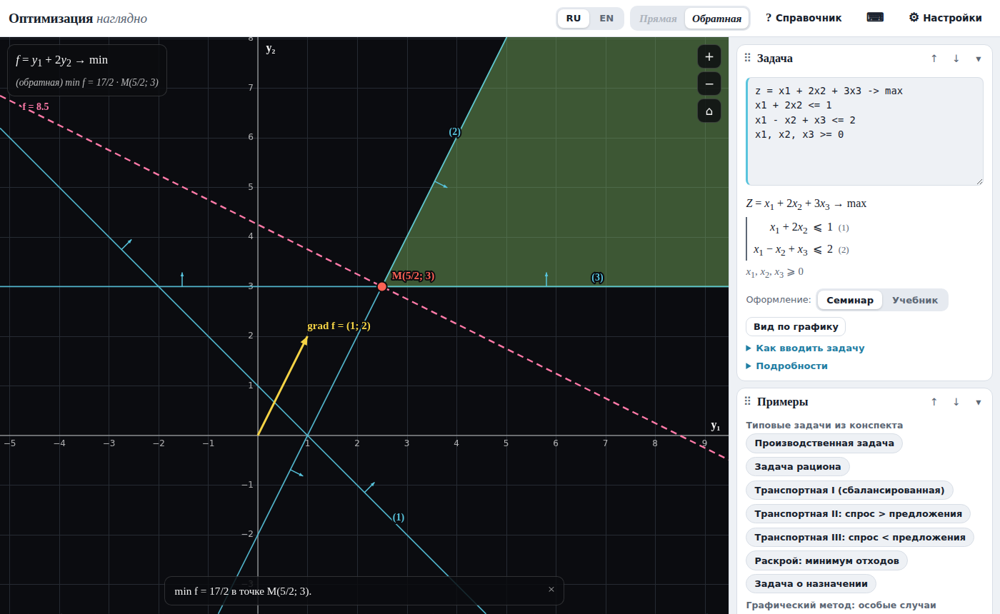
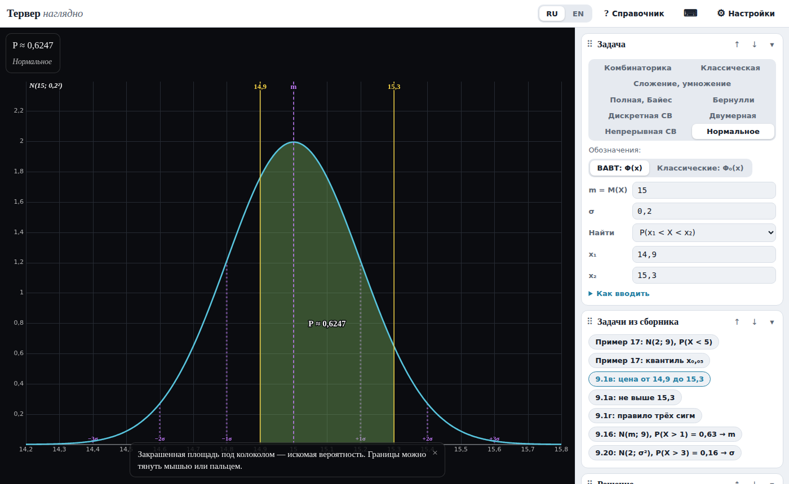

# Математика наглядно

Интерактивные тренажёры по математическим курсам для студентов ВАВТ: графики можно тянуть руками, задачи решаются по шагам, а встроенный справочник объясняет понятия интуитивно и строго.

**Открыть онлайн:** https://musalimov.github.io/vavt-math/

| | Приложение | Что внутри |
|---|---|---|
|  | [**Линейная алгебра**](linear-algebra.html) | Матрицы как преобразования плоскости и пространства, определитель, собственные векторы, ранг, 2D и 3D |
|  | [**Интегралы**](integrals.html) | Решение любого интеграла по шагам (замена, по частям, простейшие дроби, тригонометрия), определённый, неопределённый и несобственный интеграл, суммы Римана |
|  | [**Методы оптимальных решений**](optimization.html) | Графический метод, двойственная (обратная) задача, дополняющая нежёсткость, симплекс-таблицы, все решения, теневые цены и устойчивость; режим «как на семинаре» |
|  | [**Теория вероятностей**](probability.html) | Все 9 разделов задачника ВАВТ: комбинаторика, классическая вероятность, сложение и умножение, Байес, Бернулли и Муавр–Лаплас, дискретные, двумерные и непрерывные величины, нормальное распределение |

## Как пользоваться

- **Онлайн** — по ссылке выше, ничего устанавливать не нужно; работает и на телефоне.
- **Офлайн** — скачайте нужный `.html` файл и откройте его двойным щелчком в любом браузере. Без интернета вместо фирменных шрифтов подставятся системные, всё остальное работает.

Настройки, порядок блоков и отметки «прочитано» в справочнике хранятся только в вашем браузере. Никаких аккаунтов и аналитики.

## На чём основано

- «Методы оптимальных решений» — по учебнику *«Избранные лекции по методам оптимизации»* и материалам семинаров (двойственная задача через транспонирование таблицы, балансовые переменные).
- «Теория вероятностей» — по задачнику ВАВТ; обозначения как в нём (Φ(x) — функция распределения N(0; 1) от −∞), есть переключатель на классическую Φ₀(x). Ответы приложения сверены с ответами задачника.
- Номера задач и их краткие условия приведены для удобства подготовки; полные условия — в исходных пособиях.

## Как устроено

Каждое приложение — один самодостаточный HTML-файл: разметка, стили и JavaScript без фреймворков и сборки. Внешняя зависимость одна — шрифты Google Fonts.

## Ошибки и идеи

Если нашли неверный ответ или опечатку, откройте [Issue](https://github.com/Musalimov/vavt-math/issues): укажите приложение, раздел и входные данные (удобнее всего — скриншот).

## Лицензия

[MIT](LICENSE) — можно свободно пользоваться и дорабатывать с сохранением указания авторства.
